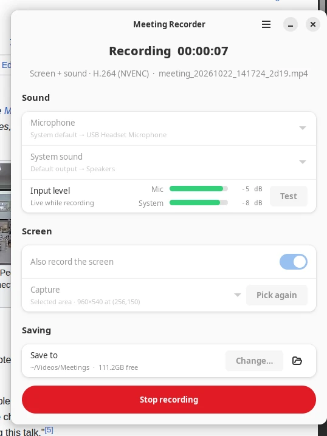
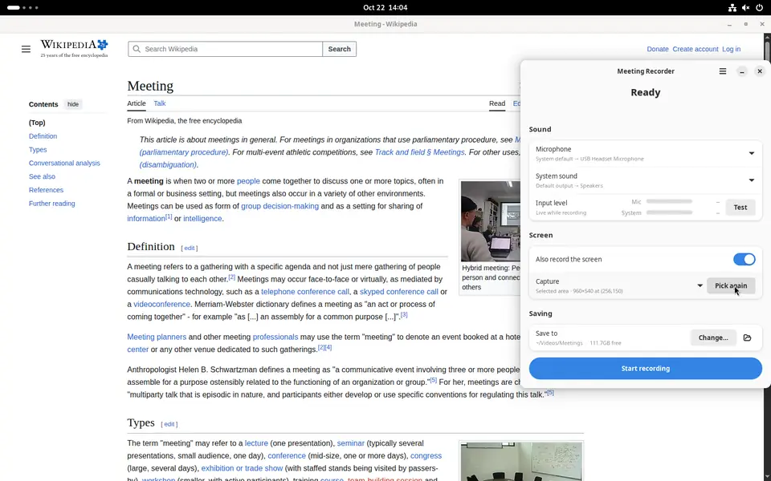
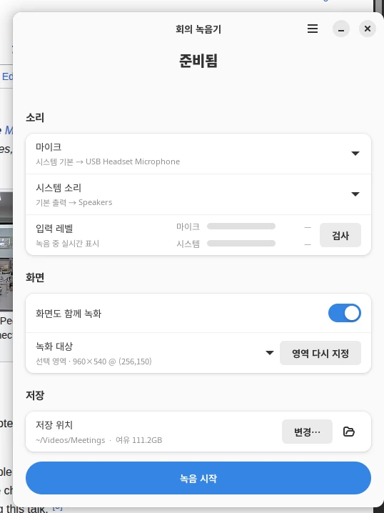

# meetrec

A small GTK4 meeting recorder for Linux. One window, one big button: it records your microphone and whatever the computer is playing (the other side of the call) into a single file, and optionally the screen, one monitor, or an area you drag out.



I wanted meeting recordings with both sides of the conversation in one file and the shared screen next to it, without setting up OBS for every call. Most of the code deals with failure cases: the window crashing mid-meeting, PipeWire renaming a headset after a re-plug, and ffmpeg being killed before it could close the file.

[한국어 설명은 아래에 있습니다.](#한국어)

## What it does

- **Microphone + system sound in one track.** System sound is the monitor of the output device you pick (or the default one). The two are mixed at full level with a limiter. The meters show each input's level as measured inside the recording process, not by a second capture. A muted microphone gets a warning after 8 seconds of silence.
- **Screen, monitor or area.** Record one monitor, the whole desktop, or a rectangle picked with a GNOME-style overlay (drag, resize from the corners, move, Enter to confirm). The mouse cursor is in the recording.
- **Hardware encoding when it works.** NVENC H.264 when the GPU accepts the frame size, NVENC HEVC for desktops wider than 4096 pixels, and x264 otherwise (at 15 fps on very large desktops, to keep the CPU load down).
- **Recording outlives the window.** ffmpeg runs as a systemd user service, so closing or crashing the window doesn't stop it, and reopening the app re-attaches. A recording that ended while no window was open is finished on the next start.
- **Matroska first, MP4 after.** ffmpeg writes a `.partial.mkv` and pushes data to disk about once a second; stopping remuxes it to MP4/M4A with a stream copy, checks the result, and only then deletes the spool. In a test where ffmpeg was killed with SIGKILL after 4 seconds, 3.9 seconds came back.
- **Devices are remembered by hardware**, not by their PipeWire node name. A saved device that is unplugged shows up as "not connected" instead of silently becoming the default.
- Recordings are created readable only by you (mode 0600). Nothing is uploaded anywhere.
- English and Korean UI.



## Install

Tested on Ubuntu 24.04 with GNOME on X11 (PipeWire 1.0.5, ffmpeg 6.1, GTK 4.14, libadwaita 1.5).

```sh
sudo apt install git make gettext python3-gi python3-gi-cairo gir1.2-gtk-4.0 \
                 gir1.2-adw-1 ffmpeg pulseaudio-utils x11-xserver-utils
git clone https://github.com/Jayyo/meetrec
cd meetrec
make install                 # into ~/.local; PREFIX=/usr/local also works
```

That puts `meetrec` in `~/.local/bin`, the package in `~/.local/share/meetrec`, and a "Meeting Recorder" entry in the app grid. `make uninstall` removes them again; your settings and recordings stay. To try it from the checkout: `./bin/meetrec` (run `make` first for the Korean translation).

Recordings go to `~/Videos/Meetings` by default (your XDG videos folder); "Change…" picks another folder. If something looks wrong while recording:

```sh
systemctl --user status meetrec-recording.service
journalctl --user -u meetrec-recording.service -n 50 -o cat
```

## How it works

| What | Why |
|---|---|
| ffmpeg runs as a `systemd-run --user` transient service | The capture belongs to systemd, not to the window. Stop is a real SIGINT with a 90 s grace period (`KillSignal=SIGINT`, `TimeoutStopSec=90`). The plan is written to `~/.local/state/meetrec/` before the service starts and the systemd invocation id right after, so a crash at any point leaves enough to re-attach or finish the file. If systemd can't be asked, nothing is finished or deleted. |
| Record to `.partial.mkv`, then remux | An MP4 killed before its index is written is hard to recover. Matroska with `-cluster_time_limit 1000` and `-flush_packets 1` gets data to disk about once a second; without those flags the file stayed at 0 bytes for the first ~10 s of an audio-only recording, so a short recording killed early left nothing. The remux is `-c copy` into a private temporary file; its tracks and duration are checked against the spool before it is published under a name that doesn't exist yet. If the result is clearly shorter than expected, the spool is kept too. |
| Devices stored by fingerprint (serial, then bus path, then vendor/product/description) | PipeWire renames nodes on re-plug and profile changes. The same headset showed up as `mono-fallback`, then `.2`, then `.3`, and its output switched between `iec958-stereo` and `analog-stereo`. |
| System sound from the sink's `monitor_source` | Gluing `.monitor` onto the sink name breaks on some setups. |
| `amix=normalize=0` + `alimiter=level=0` | `normalize` would halve each source. The limiter catches a boosted mic plus loud system sound; its auto-level is off so it doesn't push everything back to 0 dBFS. |
| Encoder picked by a two-frame test encode at the real size | `ffmpeg -encoders` only says what was compiled in. NVENC also needs a GPU, a driver and a size it accepts: h264_nvenc refused frames wider than 4096 and very small areas (144×300) on my machine. |
| Small capture queue for the screen | `thread_queue_size` counts raw frames; at 5K a frame is over 50 MB, so the queue is sized from the frame size instead of a fixed 1024. |
| Meters from the recording ffmpeg | Each input branch writes `astats` peaks through `ametadata` to a file in `$XDG_RUNTIME_DIR` ten times a second; the window reads the last line. No second capture process, and a meter that stops updating is shown as no data. |
| Area picker: one borderless fullscreen overlay per monitor | Coordinates are kept in X root-window space, which is what `x11grab` takes. The area is snapped to even sizes (yuv420p) and clamped to the screen, because a rectangle outside the root window kills x11grab on the first frame. |
| No timers while idle | The window only polls while recording. |

## Limitations

- Screen capture uses `x11grab`, so it needs an X11 session. On Wayland meetrec records audio only.
- Needs a systemd user session and PipeWire (with pipewire-pulse) or PulseAudio.
- NVENC was tested on an RTX 3090; the x264 path was tested on the same machine by making the NVENC probe fail.
- The area picker dims the screen with a translucent window, which needs a compositing window manager (GNOME's is one).
- The screenshots were taken on a virtual display with test audio playing into virtual devices.

## Development

```sh
sudo apt install python3-pytest
make check      # devices, monitors, regions, encoder choice, command lines, state, finalize
make pot        # refresh po/meetrec.pot after changing UI strings
```

`meetrec/core.py` has no GTK dependency. `MEETREC_UNIT` changes the systemd unit name and the session file that goes with it; together with `XDG_CONFIG_HOME` and `XDG_STATE_HOME` pointing elsewhere, a test run stays away from a real recording. The finalize tests generate real Matroska files with ffmpeg, including ones killed halfway.

## License

MIT, see [LICENSE](LICENSE).

---

## 한국어

마이크와 시스템 소리(통화 상대 목소리)를 한 파일에 담고, 원하면 화면이나 모니터 하나, 드래그로 지정한 영역까지 같이 녹화하는 리눅스 GTK4 회의 녹음기입니다. 창 하나, 큰 버튼 하나로 동작합니다.

- 녹음은 systemd 사용자 서비스로 돌아서 창을 닫거나 앱이 죽어도 계속됩니다. 앱을 다시 열면 진행 중인 녹음에 다시 연결되고, 창이 없는 동안 끝난 녹음은 다음 실행 때 마무리합니다.
- 녹화 중에는 Matroska 파일에 쓰고 대략 1초마다 디스크로 내보냅니다. 중지하면 재인코딩 없이 MP4/M4A로 바꾸고 결과를 검증한 뒤에만 원본을 지웁니다. 4초 녹음 중 ffmpeg를 강제 종료한 테스트에서 3.9초가 복구됐습니다.
- NVENC가 그 크기에서 동작하면 하드웨어 인코딩(4096px보다 넓은 전체 화면은 HEVC), 아니면 x264를 씁니다.
- 장치는 PipeWire 노드 이름이 아니라 하드웨어 정보로 기억하고, 빠진 장치를 다른 장치로 몰래 바꾸지 않습니다.
- 화면 녹화는 X11 세션에서만 됩니다. Wayland에서는 소리만 녹음합니다.

설치는 위의 [Install](#install)과 같습니다. 시스템 언어가 한국어이면 한국어 화면으로 뜹니다.


